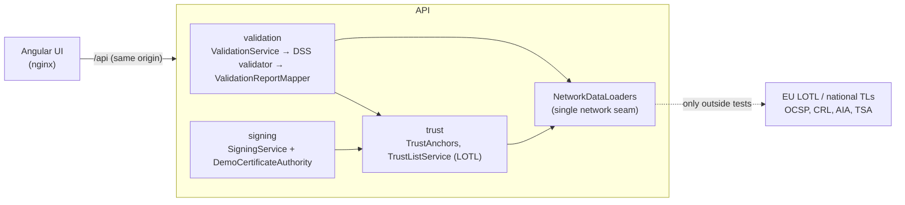

# SignCheck

[](https://github.com/PlarrubiaMontes/SignCheck/actions/workflows/backend-ci.yml)
[](https://github.com/PlarrubiaMontes/SignCheck/actions/workflows/frontend-ci.yml)
[](https://github.com/PlarrubiaMontes/SignCheck/actions/workflows/smoke.yml)


SignCheck validates advanced electronic signatures — **PAdES** (PDF), **XAdES** (XML) and **CAdES** (CMS) —
following the eIDAS regulation and the ETSI standards, and explains the result in plain language.
Upload a signed document and get a verdict per signature (*valid*, *invalid* or *indeterminate*), the reason when
it is not valid, and the evidence behind it: signer, signing time, level, certificate chain, revocation status,
timestamps and the raw ETSI reports. It can also sign documents with a **TEST-ONLY demo certificate** to try the
full sign → validate round trip.

It is built on the European Commission's [DSS (Digital Signature Services)](https://github.com/esig/dss) library,
with a Spring Boot REST API and an Angular UI. Uploaded files are processed in memory and never stored.

## Quick start

**Whole stack with Docker** (UI and API on <http://localhost:8081>):

```bash
docker compose up --build
```

**Local development** (Java 21 and Node.js 26; Maven is downloaded by the wrapper):

```bash
cd backend && ./mvnw spring-boot:run      # API on :8080, profile "dev": trust mode NONE, demo signing on
cd frontend && npm ci && npm start        # UI on http://localhost:4200, proxies /api to :8080
```

Then open the UI, go to **Sign (demo)**, sign any PDF and press **Validate it now**: the demo signature is
`VALID`. Swagger UI: <http://localhost:8080/swagger-ui.html>.

### Try it with generated samples

No real signed document is needed: the test PKI writes TEST-ONLY samples to `backend/target/samples`.

```bash
cd backend
./mvnw test -Dtest=SampleFilesGenerator -Dsamples=true
curl -F file=@target/samples/pades-tampered.pdf -H 'Accept-Language: es' http://localhost:8080/api/v1/validations
```

| Sample | Expected in the `dev` profile |
|---|---|
| `pades-tampered.pdf` | `INVALID` / `HASH_FAILURE` — "the document was modified after it was signed" |
| `pades-valid.pdf`, `xades-enveloped.xml`, `cades-attached.p7m` | `INDETERMINATE` / `NO_CERTIFICATE_CHAIN_FOUND` (the test PKI is not trusted) |
| `xades-detached.xml`, `cades-detached.p7s` without `-F originals=@target/samples/original.txt` | `INDETERMINATE` / `SIGNED_DATA_NOT_FOUND` |
| `pades-two-signatures-one-broken.pdf` | first `INDETERMINATE`, second `INVALID` / `SIG_CRYPTO_FAILURE` |
| `unsigned.pdf` | HTTP 422, `code: NO_SIGNATURE_FOUND` |

## API

| Endpoint | Purpose |
|---|---|
| `POST /api/v1/validations` | multipart `file`, optional `originals` (detached signatures), `includeRawReports` |
| `GET /api/v1/trust/status` | trust mode, Trusted List loading state and counts |
| `POST /api/v1/signatures` | demo signing: multipart `file`, `format` (`PADES`/`XADES`/`CADES`), `packaging`, `level` (`B`/`T`) |
| `GET /api/v1/signatures/options` | formats and levels available (the signing endpoints exist only when signing is enabled) |

```bash
curl -F file=@contract-signed.pdf http://localhost:8080/api/v1/validations
curl -F file=@signature.p7s -F originals=@contract.pdf -F includeRawReports=true http://localhost:8080/api/v1/validations
curl -F file=@contract.pdf -F format=PADES -OJ http://localhost:8080/api/v1/signatures      # saves contract-signed.pdf
```

Errors are RFC 9457 `application/problem+json` with a stable `code` (`NO_FILE`, `FILE_TOO_LARGE`,
`NO_SIGNATURE_FOUND`, `UNSUPPORTED_FORMAT`, `INVALID_SIGNING_REQUEST`, `VALIDATION_ERROR`). Reasons are in English
or Spanish following `Accept-Language`. Full contract: [docs/SPEC.md](docs/SPEC.md) and the OpenAPI document.

## Architecture



- **Stateless**: one request = one in-memory validation; no database.
- **DSS stays inside**: DSS reports are mapped to our own DTOs in one class; DSS types never reach the API.
- **One network seam**: every download (Trusted Lists, CRL, OCSP, AIA, TSA) goes through `NetworkDataLoaders`, with
  timeouts; tests replace it with an in-memory network.

Details: [docs/ARCHITECTURE.md](docs/ARCHITECTURE.md).

## Trust modes

A signature can only be `VALID` if its certificate chain ends in a trusted certificate (a *trust anchor*).
`signcheck.trust.mode` decides where those come from:

| Mode | Trust anchors | Revocation (OCSP/CRL) | Use |
|---|---|---|---|
| `NONE` (profile `dev`, Docker default) | none | none | development; nothing is trusted |
| `KEYSTORE` | certificates in `signcheck.trust.keystore` (PKCS#12) | online | private CAs, integration tests |
| `LOTL` | EU Trusted Lists (+ keystore if present) | online, plus AIA | real eIDAS documents |

When demo signing is enabled, the demo CA's root is also trusted (in every mode) and its CRL is answered locally,
so demo signatures are `VALID` even offline.

`LOTL` mode loads the EU List of Trusted Lists in the background (`trust/status` reports progress), accepts Trusted
Lists v5 and v6, and ignores any list whose signature or freshness check fails. The LOTL signature is checked
against the signing certificates announced in the Official Journal of the EU. Those are real EU certificates, so
they are **not** in this repository; provide them as a PKCS#12 file:

```bash
LOTL_KEYSTORE=/path/oj-keystore.p12 LOTL_KEYSTORE_PASSWORD=... \
  docker compose -f docker-compose.yml -f docker-compose.lotl.yml up --build
```

## Key decisions

1. **DSS instead of hand-written cryptography** — DSS is the reference implementation of the ETSI validation
   process; our effort goes to the API, the UX and the quality around it.
2. **Own DTOs over DSS types** — a stable, documented API that does not change with DSS upgrades.
3. **Stateless, no persistence** — privacy by design: files live in memory for one request and only metadata is logged.
4. **Generated test PKI** — reproducible tests with no real certificates or personal data, and no internet in CI.
5. **Trust modes** — useful offline for development and demos, fully eIDAS-aware with the EU Trusted Lists.
6. **Demo CA generated at runtime** — the signing demo needs keys, but none are committed: the application
   generates a TEST-ONLY CA on first start, outside the repository, and reuses it.

## Testing

```bash
cd backend && ./mvnw verify     # 160+ tests, ~40 s, no network
cd frontend && npm test         # Vitest unit tests
```

- A **test PKI** (BouncyCastle) builds root, intermediate, valid / expired / not-yet-valid / revoked /
  wrong-key-usage / untrusted signers, CRLs, a TSA and Trusted List signers on every run.
- **Signed samples** are produced on the fly with DSS (PAdES B/T, XAdES enveloped/enveloping/detached, CAdES
  attached/detached), plus tampered and broken copies.
- API tests run the **real trust configuration** (`KEYSTORE` mode, and `LOTL` mode with a generated, XSD-valid,
  signed LOTL and Trusted List) against an in-memory network.
- The validation matrix of [ARCHITECTURE §5](docs/ARCHITECTURE.md) asserts the verdict and ETSI sub-indication of
  each case; the frontend tests cover services, i18n and the main components.
- CI: backend and frontend workflows, plus a Docker smoke test that starts the whole stack with `docker compose`.

## Tech stack

Java 21 · Spring Boot 4.1 · EU DSS 6.5.1 · springdoc-openapi 3.2 · BouncyCastle 1.86 (via DSS) ·
Angular 22 (standalone, signals, zoneless) · Vitest · Docker (Temurin 21 JRE, nginx unprivileged) · GitHub Actions.

DSS modules are declared one by one (only those in use), with versions from `dss-bom`. `dss-bom` inherits
third-party versions from its parent POM, so `pom.xml` imports Spring Boot's BOM first to keep Spring Boot in
charge of shared libraries (JUnit, JAXB, Mockito); `DssClasspathTest` checks that exactly one implementation of
each pluggable DSS service (utils, CMS, CRL parser, PDF backend) is present.

## Roadmap

Phases 0–5 and 7 are done; phase 6 (delivery) is done except the optional public demo, and the manual check of the
real EU LOTL (3.2) is pending. See [docs/ROADMAP.md](docs/ROADMAP.md).

## License

[Apache License 2.0](LICENSE). SignCheck uses the [EU DSS library](https://github.com/esig/dss), © European
Commission, licensed under LGPL-2.1.
